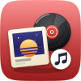
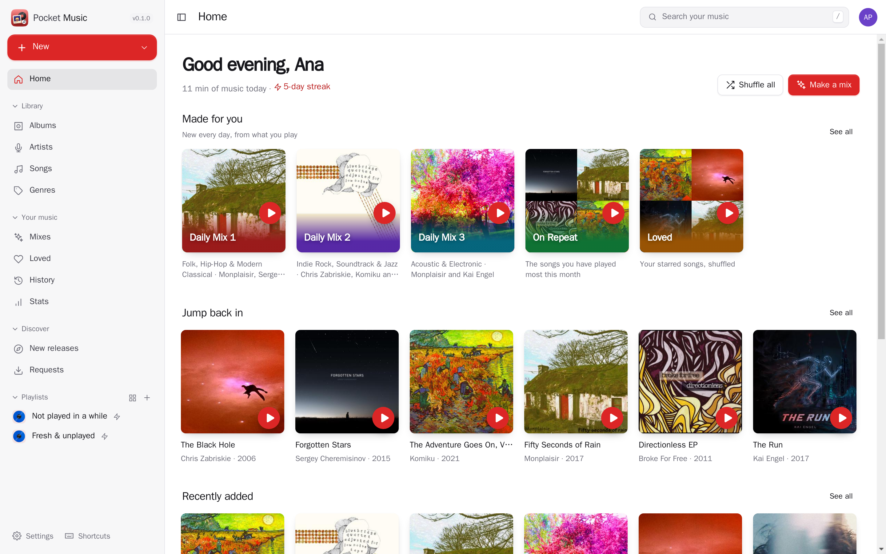
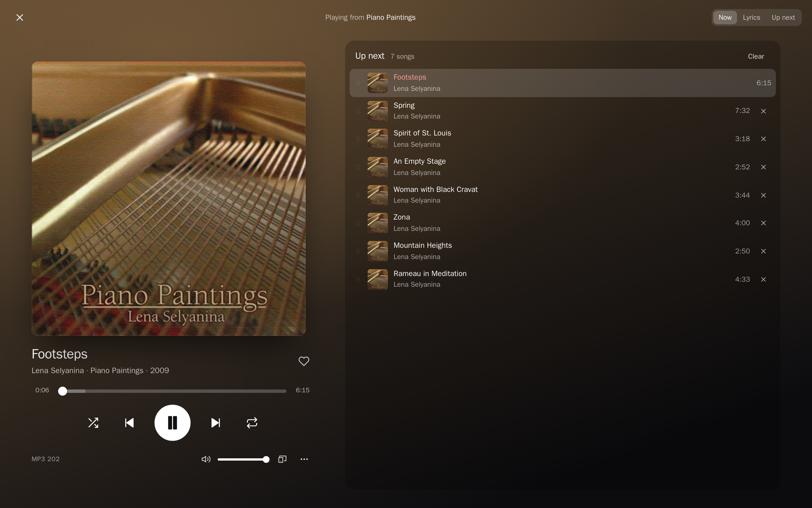
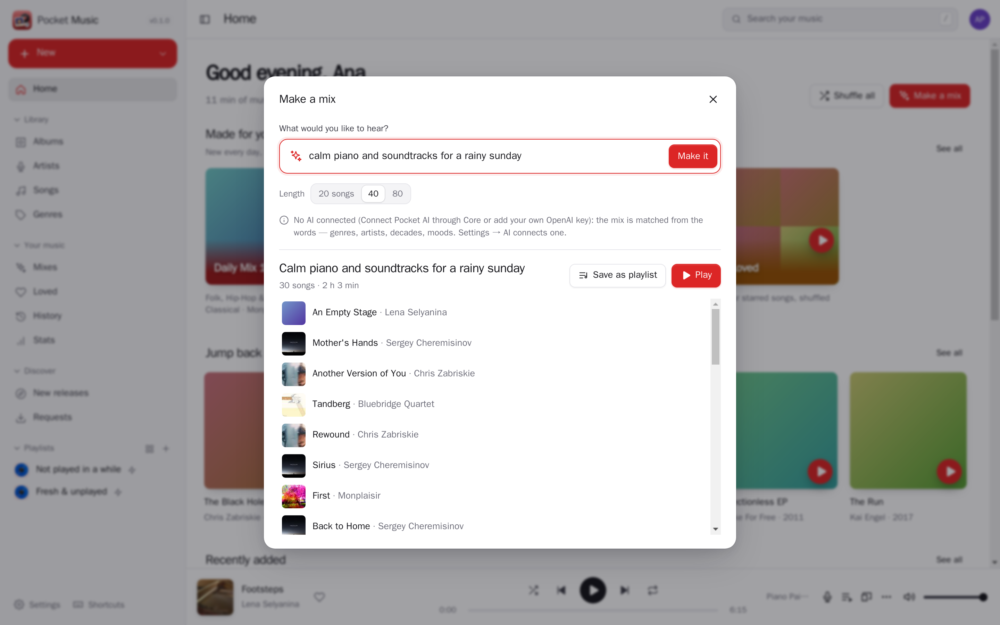
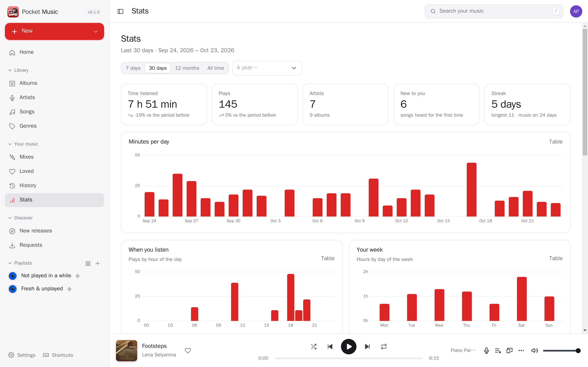
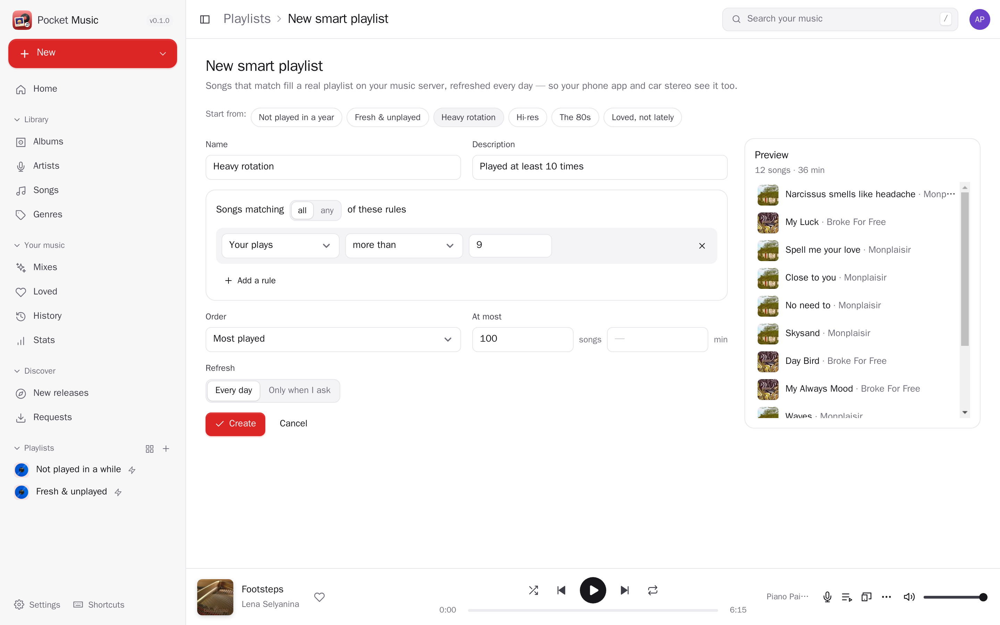
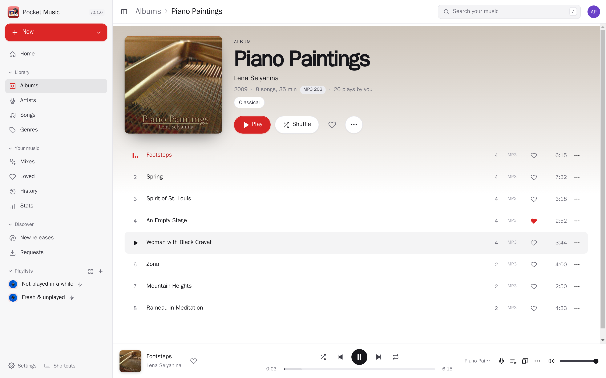
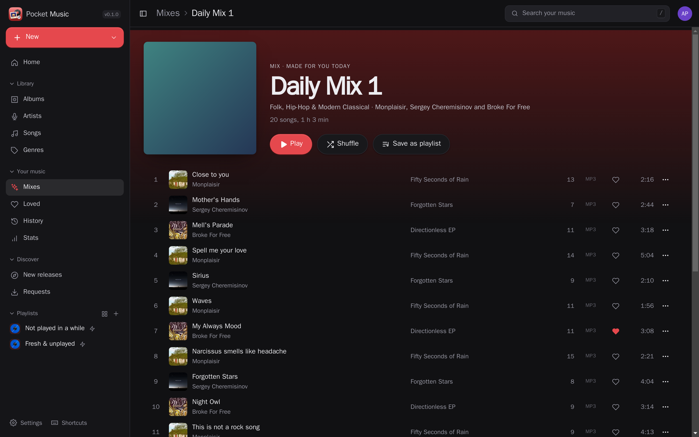
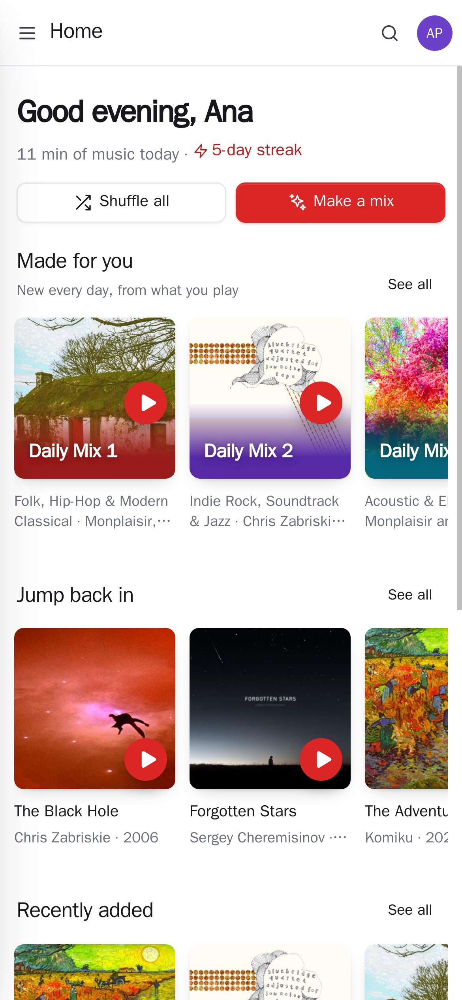
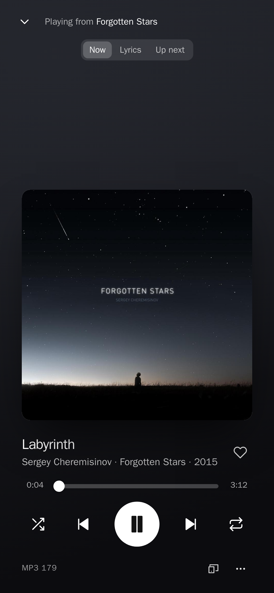

<p align="center"></p>
<h1 align="center">Pocket Music</h1>
<p align="center">Your music library, played anywhere: a player for the whole household on top of Navidrome, with your listening history and stats, daily mixes and radio, smart playlists every Subsonic app sees, synced lyrics, “make me a mix” from a sentence, the albums you’re missing fetched through Lidarr, and YouTube links saved into the library as proper albums.<br>Comes with its own Navidrome, set up for you — or works with yours.</p>
<p align="center">
  <a href="https://github.com/abjelosevic88/pocket-homelab-music/actions"></a>
  <a href="https://github.com/abjelosevic88/pocket-homelab-music/pkgs/container/pocket-homelab-music"></a>
  <a href="LICENSE"></a>
</p>

---

<p align="center"></p>

<table>
  <tr>
    <td width="50%"></td>
    <td width="50%"></td>
  </tr>
  <tr>
    <td align="center"><sub>Now Playing: synced lyrics, the queue, quality, sleep timer, your other devices.</sub></td>
    <td align="center"><sub>“Make a mix”: a sentence becomes a playlist — only music you own.</sub></td>
  </tr>
  <tr>
    <td width="50%"></td>
    <td width="50%"></td>
  </tr>
  <tr>
    <td align="center"><sub>Stats from every play: minutes, streaks, top artists, when you listen.</sub></td>
    <td align="center"><sub>Smart playlists, written back to Navidrome so every player sees them.</sub></td>
  </tr>
  <tr>
    <td width="50%"></td>
    <td width="50%"></td>
  </tr>
  <tr>
    <td align="center"><sub>Albums with quality, your plays, loves; gapless, with volume levelling.</sub></td>
    <td align="center"><sub>Dark mode.</sub></td>
  </tr>
</table>

<p align="center">
  &nbsp;&nbsp;
  
</p>

## Why on top of Navidrome

Navidrome already does the server part very well — scanning tens of thousands of files, tags, artwork, transcoding,
and the Subsonic API every phone, desktop and car app speaks. Pocket Music doesn’t replace any of that: it plays
your library *through* Navidrome, with each person’s own account, and adds what a server doesn’t do — knowing what
you listen to, making something new from your own shelves every day, telling you what’s missing, and connecting
your music to the rest of your Pocket apps. Keep using any Subsonic app alongside: playlists, smart playlists, loves
and play counts show up there too. More in [docs/design.md](docs/design.md).

## Navidrome included, or bring your own

**No music server yet?** Pocket Music can bring its own Navidrome, and you never have to open it:

- It runs next to Pocket Music with no port of its own, over the same music folder. Only the app talks to it.
- On the first start Pocket Music makes Navidrome's first account for you.
- Everyone who signs in to Pocket Music gets their own Navidrome account automatically, so playlists, loves and play
  counts stay theirs. Phone and car apps sign in through Pocket Music's own Subsonic address.
- New albums show up within a minute.

**Already run Navidrome?** Point Pocket Music at it instead. It never changes a Navidrome that already has accounts;
everyone signs in with their own account there.

The same [docker-compose.yml](docker-compose.yml) does both: the bundled Navidrome is its `navidrome` profile.

## What it does

**A player for everyone in the house**
- Albums, artists, songs, genres and playlists from a local index of each person’s library — browsing and search
  are instant even at 40,000 songs (accents ignored, prefix matching).
- Gapless playback (the next song loads while this one plays) or a crossfade, volume levelling from ReplayGain tags,
  lock-screen and media-key controls, a sleep timer, keyboard shortcuts, ⌘K search.
- Original files, or transcoded by Navidrome on phones and slow connections (per device); formats a browser can’t
  play — DSD, APE, WavPack — are transcoded by themselves.
- Synced lyrics that follow the song (tap a line to jump there): from your files first, LRCLIB after — size,
  preference and “open on the lyrics” are yours to set.
- **Lyrics library**: synced lyrics fetched every night for the whole library and saved as `.lrc` files next to the
  songs, so every player has them; retry days, plain-lyrics handling, pacing, schedule, notifications — all
  settings, with a run history and *Run now*. *Save to library* from Now Playing for one song.
- **Lyrics page**: every song’s lyrics in one place — filter synced / plain / without, search the words, fetch the
  missing ones (one song or all of a search), pick between LRCLIB’s matches, edit, shift the timings, tap along to
  sync plain lyrics, delete wrong ones. Saved to the files, so every app has the fix.
- **Offline**: download an album, playlist or mix onto the phone or laptop (original or 320/256/128 kbps); it plays
  and seeks without a network, plays made offline are counted when you’re back, and the app itself opens offline.
- **Phone & car apps**: any Subsonic app (Amperfy, play:Sub, Symfonium…) signs in with a Pocket Music app login,
  and its plays count in your history and stats. Daily mixes can be published as playlists for those apps.
- Every open Pocket Music is a device: see “Playing on iPhone”, pause or skip it, or **Play here** to move the queue
  and position over.

**Made from what you play**
- Every play is kept (half the song or four minutes, like Last.fm) and passed on to Navidrome → Last.fm,
  ListenBrainz or Maloja. Import your past from Maloja or ListenBrainz.
- Daily Mix 1–4 by favourite genres, On Repeat, Rediscover, Fresh in your library, Deep Cuts, Time Capsule, Loved,
  Focus — new each day.
- Radio from any song, album, artist or genre: Navidrome’s similar songs blended with what you played around them.
- **Make a mix** from a sentence — “calm piano for a rainy Sunday”, “80s for the gym”. The AI (Pocket AI or your
  own OpenAI-compatible key) sees only your genre and artist names and answers with a plan that runs over your
  library; without AI the plan is read from the words.
- Smart playlists from rules (genre, year, plays, last played, added, loved, rating, format, bitrate…), refreshed
  daily *as real playlists on the server*: your phone app and car stereo see them.
- Stats for any period — minutes, plays, new songs, streaks, top artists, albums, songs and genres, hour of day and
  weekday — and “your year in music”.

**What’s missing, one click away** (with Lidarr)
- Artist pages show the whole discography with the albums you don’t have; *Get it* asks Lidarr.
- New releases by your artists, and a search for any album on MusicBrainz.
- Requests are followed; a push (Apprise, ntfy, webhook) tells you when the album has arrived.

**From a link** (admins, needs `MUSIC_DIR`)
- *New → Add from a link*: paste a YouTube video or playlist (Bandcamp, SoundCloud and the other yt-dlp sites work
  too). Artist, album, year and track titles are guessed — YouTube Music’s own fields when there are any, otherwise
  the channel and a cleaned-up title — and you can change them before it starts.
- The best audio is kept as it is (opus or AAC, no re-encoding) and filed like the rest of the library:
  `<Artist>/<YYYY - Album>/NN. Title.ext`, tags, a square `cover.jpg`, the picture in the file, the channel’s picture
  as `artist.jpg` for a new artist. Existing artist and album folders are reused (any capitalisation; a track joins an
  album with the next number). An *Ambient* folder option files long ambient videos as one album each.
- Optionally into a playlist (an existing one or a new one typed in), added once the server has scanned the files.
- The music server scans when it’s done; the downloads are listed on Requests.

**Part of the Pocket apps** (with [Pocket Core](https://github.com/abjelosevic88/pocket-homelab-core))
- One sign-in; each person’s Navidrome and Lidarr login comes from Core — nothing to paste.
- Pocket Day can write “what you listened to” into your journal (`listening:read`); other apps can make playlists
  for you (`playlists:write`); events for loves, playlists, requests and arrivals.
- Strictly per person: plays, stats, mixes and settings are yours; admins don’t see anyone else’s listening.

## Run it

Pick one of three ways. Whichever you choose, open Pocket Music afterwards and create the first account. See
[docs/configuration.md](docs/configuration.md) for every option, [docs/api.md](docs/api.md) for the API (and a
Homepage widget), [docs/reverse-proxy.md](docs/reverse-proxy.md) and [docs/backup.md](docs/backup.md).

### With Pocket Core: one click

In [Pocket Core](https://github.com/abjelosevic88/pocket-homelab-core), go to **Apps → Install app → Pocket Music**.
It installs Pocket Music with its own Navidrome, creates a `music` folder in the app's folder, and signs everyone in
with Pocket Core. Copy your albums in, and that's all.

### With its own Navidrome (Docker Compose)

Download [docker-compose.yml](docker-compose.yml) and [.env.example](.env.example) (save it as `.env` and set
`BASE_URL`), then:

```sh
mkdir -p music                       # or set MUSIC_FOLDER in .env to your music folder
docker compose up -d                 # .env has COMPOSE_PROFILES=navidrome: the app and Navidrome start together
```

- Pocket Music makes Navidrome's first account a few seconds after the first start.
- Albums go in `music` as `Artist/YYYY - Album/NN. Title.flac` (any layout Navidrome reads works). Navidrome notices
  new albums within a minute, and rescans every hour anyway.
- Lyrics and "Add from a link" write into the same folder.
- Navidrome has no port of its own. Phone and car apps use Pocket Music's own Subsonic address (Settings → Phone &
  car apps). For Navidrome's web player, uncomment `4533` under `ports` in the compose file; the user is
  `pocket-music`, and admins find the password under Settings → Library.

### With the Navidrome you already run

Use the same compose file without the profile: drop `COMPOSE_PROFILES` from `.env`, point Pocket Music at your server,
and set `MUSIC_FOLDER` to the folder your server reads (for lyrics and link downloads).

```sh
NAVIDROME_URL=http://your-navidrome:4533 MUSIC_FOLDER=/srv/music docker compose up -d
```

Or as a single container:

```sh
docker run -d --name pocket-music -p 8080:8080 -v ./data:/data \
  -e BASE_URL=https://music.example.com -e SECURE_COOKIES=true \
  -e NAVIDROME_URL=http://navidrome:4533 \
  ghcr.io/abjelosevic88/pocket-homelab-music:latest
```

Everyone connects their own account under Settings → Library (or the login Pocket Core keeps for them). Pocket Music
never changes a Navidrome that already has accounts; any OpenSubsonic server works this way too.

Switching an install later: to move from the included Navidrome to yours, remove `COMPOSE_PROFILES` from `.env`, set
`NAVIDROME_URL`, then run `docker compose stop navidrome && docker compose up -d`.

Try it with a Creative Commons demo library: [scripts/demo-library](scripts/demo-library) fetches ten albums and runs
a throwaway Navidrome; then `make web build && DATA_DIR=/tmp/pm DEMO_DATA=true AUTH_MODE=none NAVIDROME_URL=http://127.0.0.1:4535 NAVIDROME_USER=admin NAVIDROME_PASSWORD=devpass123 ./pocket-music`.
The screenshots above are that library (credits in [CREDITS.md](scripts/demo-library/CREDITS.md)).

## Built with

Go, chi, SQLite (modernc, FTS5), React 19, Vite. The bundled Navidrome is the official `deluan/navidrome` image
(tested with 0.64). Works with your own Navidrome and other OpenSubsonic servers; works alone,
and with [Pocket Core](https://github.com/abjelosevic88/pocket-homelab-core) for single sign-on, paired phones and
the links between apps. MIT licensed.
