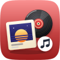
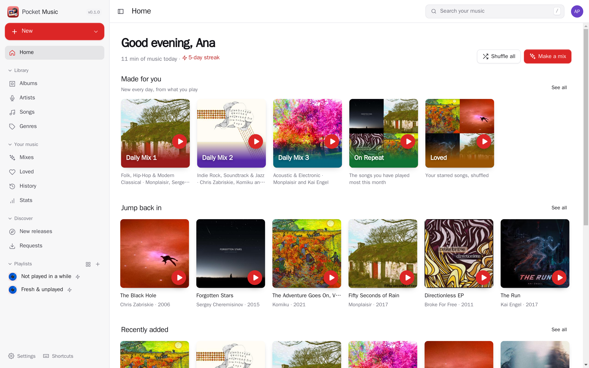
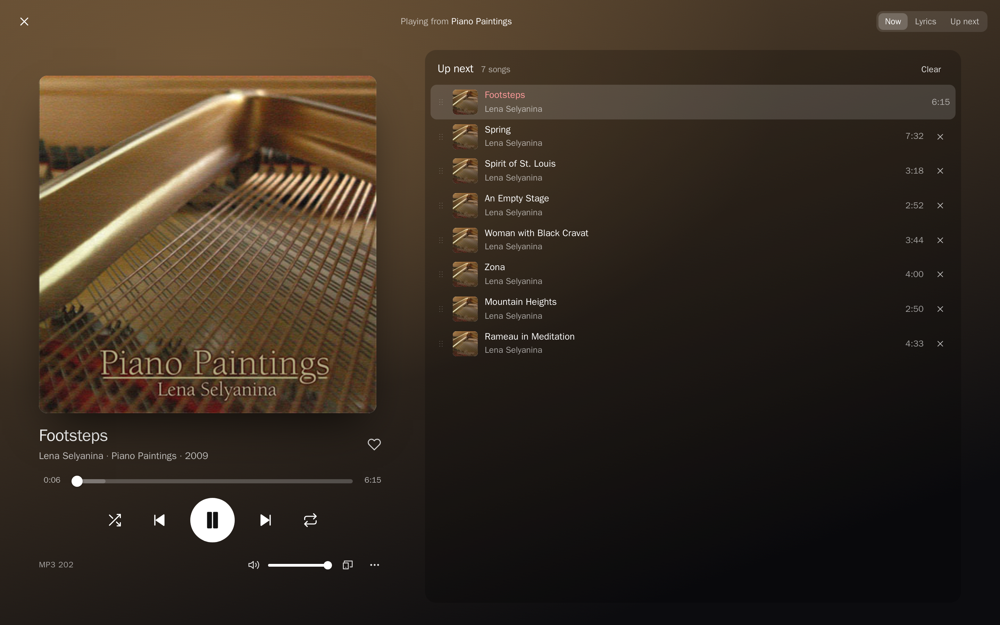
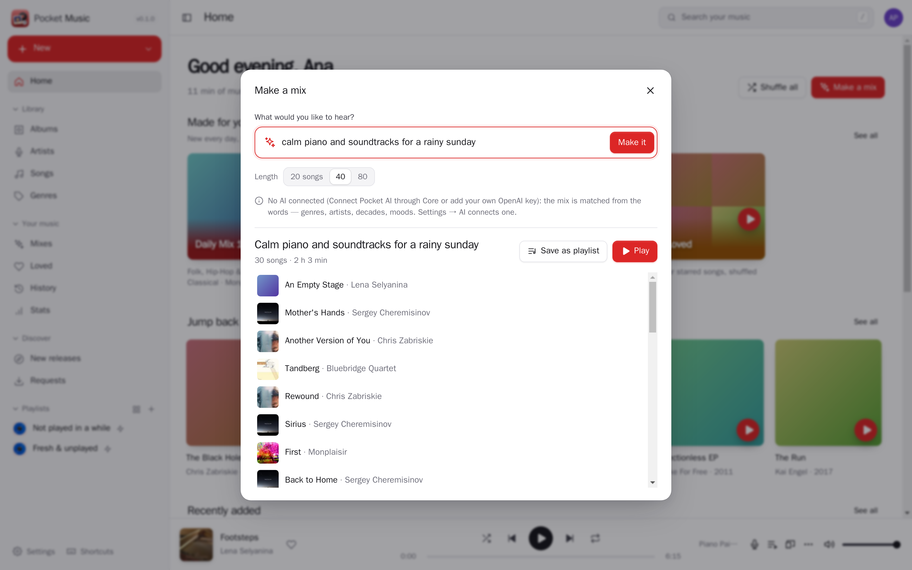
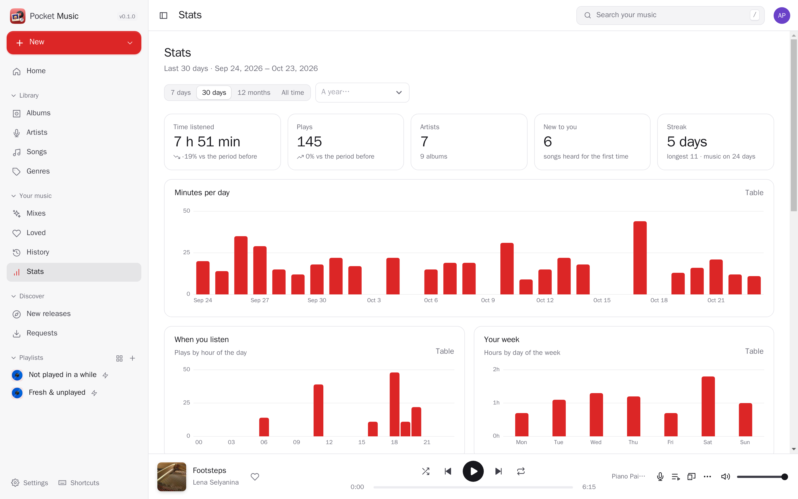
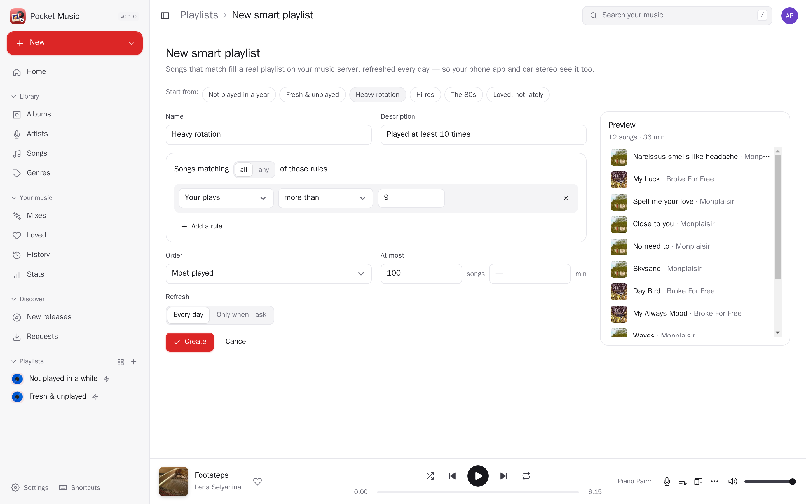
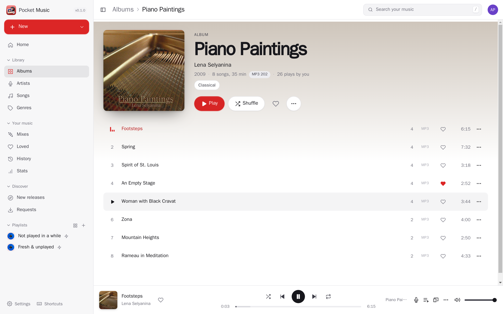
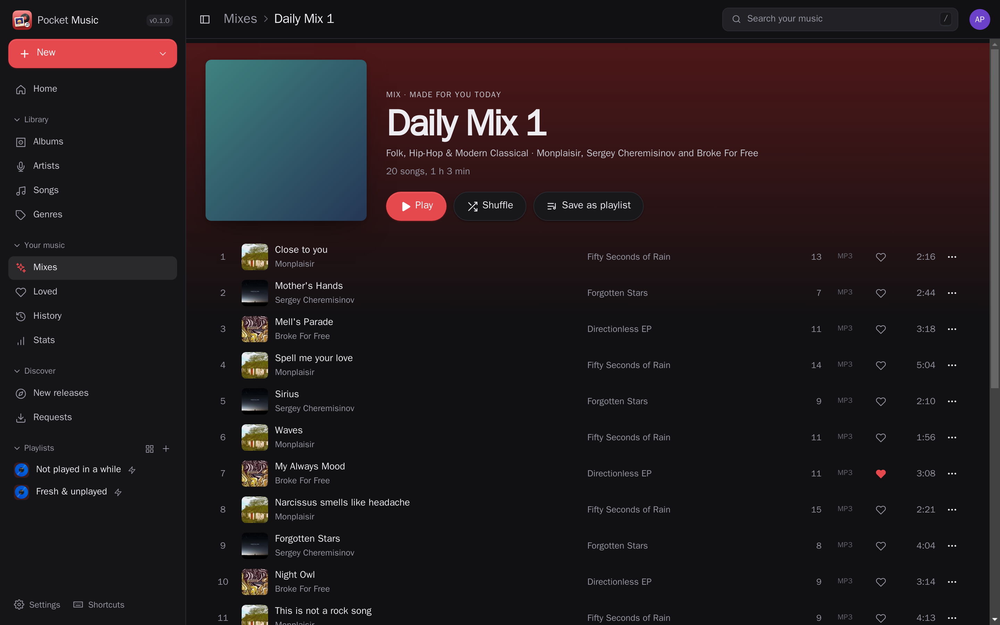
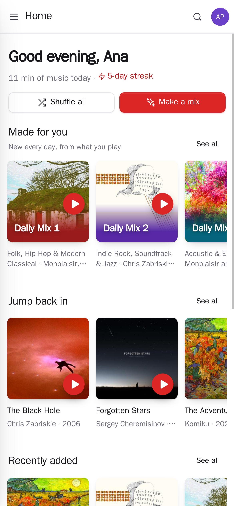
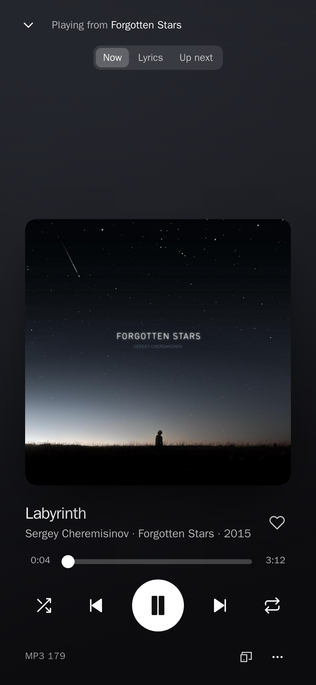

<p align="center"></p>
<h1 align="center">Pocket Music</h1>
<p align="center">Your music library, played anywhere: a player for the whole household on top of Navidrome, with your listening history and stats, daily mixes and radio, smart playlists every Subsonic app sees, synced lyrics, “make me a mix” from a sentence, and the albums you’re missing fetched through Lidarr.<br>One Go binary, one SQLite file, one volume.</p>
<p align="center">
  <a href="https://github.com/abjelosevic88/pocket-homelab-music/actions"></a>
  <a href="https://github.com/abjelosevic88/pocket-homelab-music/pkgs/container/pocket-homelab-music"></a>
  <a href="LICENSE"></a>
</p>

---

<p align="center"></p>

<table>
  <tr>
    <td width="50%"></td>
    <td width="50%"></td>
  </tr>
  <tr>
    <td align="center"><sub>Now Playing: synced lyrics, the queue, quality, sleep timer, your other devices.</sub></td>
    <td align="center"><sub>“Make a mix”: a sentence becomes a playlist — only music you own.</sub></td>
  </tr>
  <tr>
    <td width="50%"></td>
    <td width="50%"></td>
  </tr>
  <tr>
    <td align="center"><sub>Stats from every play: minutes, streaks, top artists, when you listen.</sub></td>
    <td align="center"><sub>Smart playlists, written back to Navidrome so every player sees them.</sub></td>
  </tr>
  <tr>
    <td width="50%"></td>
    <td width="50%"></td>
  </tr>
  <tr>
    <td align="center"><sub>Albums with quality, your plays, loves; gapless, with volume levelling.</sub></td>
    <td align="center"><sub>Dark mode.</sub></td>
  </tr>
</table>

<p align="center">
  &nbsp;&nbsp;
  
</p>

## Why on top of Navidrome

Navidrome already does the server part very well — scanning tens of thousands of files, tags, artwork, transcoding,
and the Subsonic API every phone, desktop and car app speaks. Pocket Music doesn’t replace any of that: it plays
your library *through* Navidrome, with each person’s own account, and adds what a server doesn’t do — knowing what
you listen to, making something new from your own shelves every day, telling you what’s missing, and connecting
your music to the rest of your Pocket apps. Keep using any Subsonic app alongside: playlists, smart playlists, loves
and play counts show up there too. More in [docs/design.md](docs/design.md).

## What it does

**A player for everyone in the house**
- Albums, artists, songs, genres and playlists from a local index of each person’s library — browsing and search
  are instant even at 40,000 songs (accents ignored, prefix matching).
- Gapless playback (the next song loads while this one plays) or a crossfade, volume levelling from ReplayGain tags,
  lock-screen and media-key controls, a sleep timer, keyboard shortcuts, ⌘K search.
- Original files, or transcoded by Navidrome on phones and slow connections (per device); formats a browser can’t
  play — DSD, APE, WavPack — are transcoded by themselves.
- Synced lyrics that follow the song (tap a line to jump there): from your files first, LRCLIB after.
- Every open Pocket Music is a device: see “Playing on iPhone”, pause or skip it, or **Play here** to move the queue
  and position over.

**Made from what you play**
- Every play is kept (half the song or four minutes, like Last.fm) and passed on to Navidrome → Last.fm,
  ListenBrainz or Maloja. Import your past from Maloja or ListenBrainz.
- Daily Mix 1–4 by favourite genres, On Repeat, Rediscover, Fresh in your library, Deep Cuts, Time Capsule, Loved,
  Focus — new each day.
- Radio from any song, album, artist or genre: Navidrome’s similar songs blended with what you played around them.
- **Make a mix** from a sentence — “calm piano for a rainy Sunday”, “80s for the gym”. The AI (Pocket AI or your
  own OpenAI-compatible key) sees only your genre and artist names and answers with a plan that runs over your
  library; without AI the plan is read from the words.
- Smart playlists from rules (genre, year, plays, last played, added, loved, rating, format, bitrate…), refreshed
  daily *as real playlists on the server*: your phone app and car stereo see them.
- Stats for any period — minutes, plays, new songs, streaks, top artists, albums, songs and genres, hour of day and
  weekday — and “your year in music”.

**What’s missing, one click away** (with Lidarr)
- Artist pages show the whole discography with the albums you don’t have; *Get it* asks Lidarr.
- New releases by your artists, and a search for any album on MusicBrainz.
- Requests are followed; a push (Apprise, ntfy, webhook) tells you when the album has arrived.

**Part of the Pocket apps** (with [Pocket Core](https://github.com/abjelosevic88/pocket-homelab-core))
- One sign-in; each person’s Navidrome and Lidarr login comes from Core — nothing to paste.
- Pocket Day can write “what you listened to” into your journal (`listening:read`); other apps can make playlists
  for you (`playlists:write`); events for loves, playlists, requests and arrivals.
- Strictly per person: plays, stats, mixes and settings are yours; admins don’t see anyone else’s listening.

## Run it

```sh
docker run -d --name pocket-music -p 8080:8080 -v ./data:/data \
  -e BASE_URL=https://music.example.com -e SECURE_COOKIES=true \
  -e NAVIDROME_URL=http://navidrome:4533 \
  ghcr.io/abjelosevic88/pocket-homelab-music:latest
```

Open it, create the first account, then connect your Navidrome account under Settings → Library. See
[docs/configuration.md](docs/configuration.md) for every option, [docs/api.md](docs/api.md) for the API (and a
Homepage widget), [docs/reverse-proxy.md](docs/reverse-proxy.md) and [docs/backup.md](docs/backup.md).

Try it with a Creative Commons demo library: [scripts/demo-library](scripts/demo-library) fetches ten albums and runs
a throwaway Navidrome; then `make web build && DATA_DIR=/tmp/pm DEMO_DATA=true AUTH_MODE=none NAVIDROME_URL=http://127.0.0.1:4535 NAVIDROME_USER=admin NAVIDROME_PASSWORD=devpass123 ./pocket-music`.
The screenshots above are that library (credits in [CREDITS.md](scripts/demo-library/CREDITS.md)).

## Built with

Go, chi, SQLite (modernc, FTS5), React 19, Vite. Works with Navidrome and other OpenSubsonic servers; works alone,
and with [Pocket Core](https://github.com/abjelosevic88/pocket-homelab-core) for single sign-on, paired phones and
the links between apps. MIT licensed.
